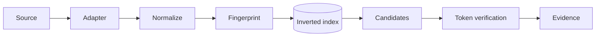

# openCODE

openCODE is a planned open-source engine for deterministic code fingerprinting, Type 1/Type 2 clone detection, and evidence-based similarity search across files and repositories. Similarity is evidence of shared lexical structure, not proof of plagiarism or authorship.

This repository is currently in the specification phase; no application implementation is claimed. The authoritative formal contracts are under [`specs/`](specs/requirements.md), supporting design material is under [`docs/`](docs/00-project-vision.md), and decisions are under [`docs/adr/`](docs/adr/ADR-001-technology-stack.md).

## MVP design

Python, JavaScript, TypeScript, and Java are tokenized by versioned adapters. Two deterministic normalized streams feed 25-token rolling hashes and rightmost-minimum Winnowing. An inverted index retrieves candidates; token verification reconstructs source spans and conservatively labels Type 1 or Type 2 clones.

Start with [project vision](docs/00-project-vision.md), [requirements](specs/requirements.md), [architecture](specs/architecture.md), and the [implementation roadmap](docs/18-implementation-roadmap.md). Contributors and coding agents must follow [AGENTS.md](AGENTS.md). No analyzed source is ever executed.
