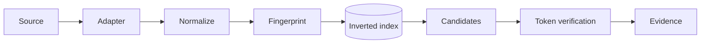

# openCODE

openCODE is an open-source engine for evidence-based Type 1 exact, Type 2 renamed, Type 3 near-miss, and Type 4 semantic code-clone search across files and repositories. Delivery is phased, and semantic embedding similarity is a speculative candidate signal—not proof of equivalence, plagiarism, or authorship.

The authoritative formal contracts are under [`specs/`](specs/requirements.md), supporting design material is under [`docs/`](docs/00-project-vision.md), and decisions are under [`docs/adr/`](docs/adr/ADR-001-technology-stack.md). Implementation proceeds strictly in the milestones defined by the roadmap; the requirements-to-code ownership map is in [`specs/implementation-map.md`](specs/implementation-map.md).

## MVP design

Python, JavaScript, TypeScript, and Java are tokenized by versioned adapters. Two deterministic normalized streams feed 25-token rolling hashes and rightmost-minimum Winnowing. An inverted index retrieves candidates; token verification reconstructs source spans and conservatively labels Type 1 or Type 2 clones.

The complete architecture adds pluggable structural and semantic detectors. Type 3 uses AST fingerprints and token/structure alignment. Type 4 begins with embedding-based candidate retrieval and requires independent program-analysis evidence before a result may be called verified. See the [detector contracts](specs/detection-engines.md).



Start with [project vision](docs/00-project-vision.md), [requirements](specs/requirements.md), [architecture](specs/architecture.md), and the [implementation roadmap](docs/18-implementation-roadmap.md). Contributors and coding agents must follow [AGENTS.md](AGENTS.md). No analyzed source is ever executed.

## Development

Python 3.12 or newer is required. The M0 workspace can be verified without any database, queue, container, or frontend service:

```console
python -m venv .venv
. .venv/bin/activate
python -m pip install -r requirements.lock
python -m pip install --no-deps -e .
ruff check .
mypy
pytest --cov
python -m build
```

Copy `.env.example` to `.env` only for local overrides; `.env` is ignored and must never be committed.

The standalone M7 CLI is available after installation:

```console
opencode scan ./repository
opencode find-clones ./repository --format json
opencode find-clones ./repository --type 3,4 --verify-semantic --format json
opencode compare file1.py file2.py --json
opencode stats ./repository
opencode benchmark ./repository --runs 3
```

## API and worker

Apply the database migration and start the production adapters with:

```console
alembic upgrade head
python -m uvicorn opencode_api.app:app --host 0.0.0.0 --port 8000
python -m opencode_worker
```

Alternatively, `docker compose up --build` starts PostgreSQL, the API, and the durable scan worker. Local-path repository ingestion is allowlist-bound; source is parsed as untrusted data and is never executed.
