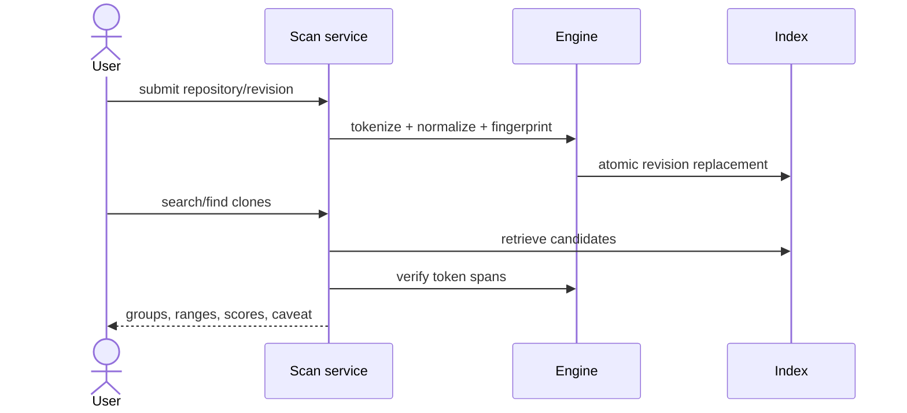

# Functional Specification

A scan enumerates bounded safe files, detects language, produces exact/renamed streams, fingerprints fragments, and atomically activates a revision. Search fingerprints a submitted fragment with the same versions; clone discovery queries indexed revisions. Candidate retrieval uses shared non-stop fingerprints. Verification reconstructs maximal equal-token spans, maps positions through token source spans, merges overlaps, and deduplicates canonical pairs.

Later phases add independent structural and semantic retrieval indexes. Structural candidates are verified by AST and token alignment. Semantic embeddings generate candidate-only results; program-analysis evidence may verify a subset under a versioned policy. Unified aggregation retains all contributing evidence and never upgrades evidence state merely because another engine reports a high score.

Scan states are `queued → running → completed|partial|failed|cancelled`; terminal states are immutable. Results include versions, skips, diagnostics, clone type, ranges, and distinct overlap/coverage scores. Exact behavior is normative in [architecture](../specs/architecture.md), [algorithm contracts](../specs/algorithm-contracts.md), [API](../specs/api-contracts.md), and [CLI](../specs/cli-contracts.md).
