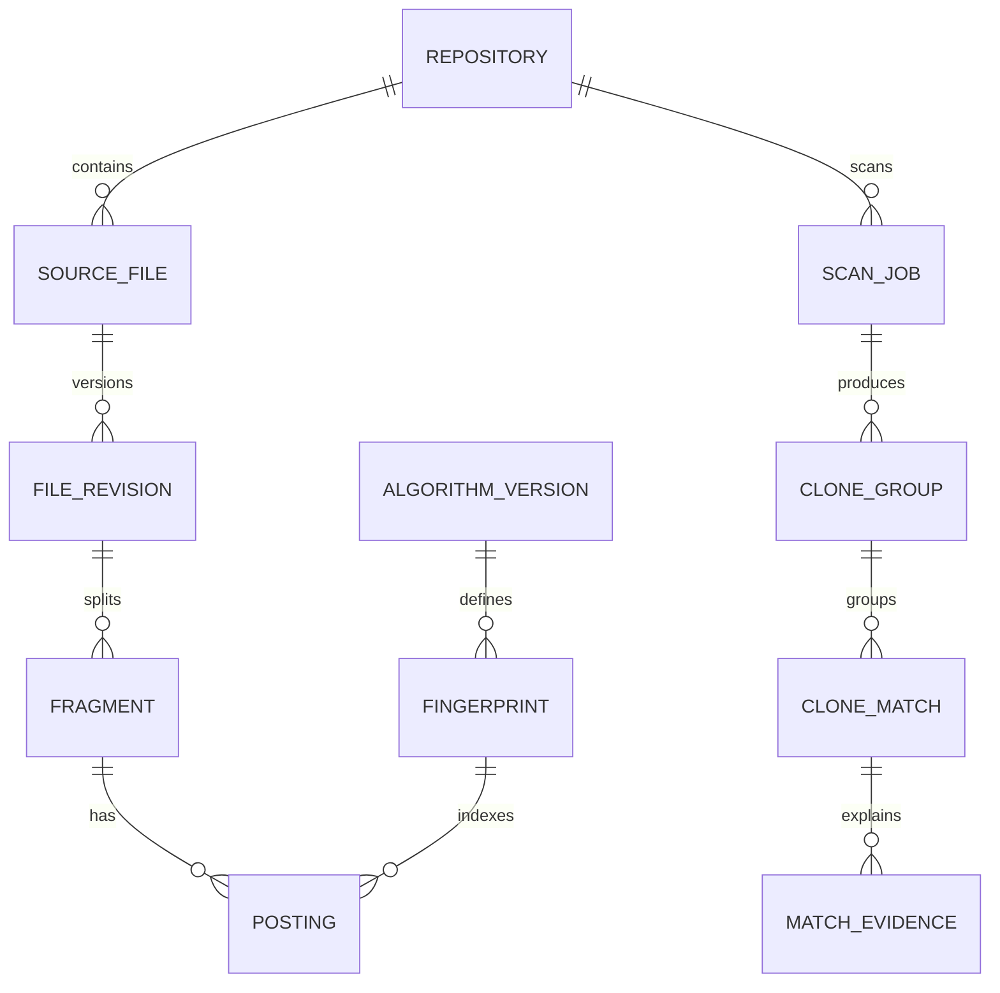

# Database Design

PostgreSQL stores metadata, versioned algorithms, scan state, fragments, postings, matches, and evidence; a restricted blob adapter optionally stores source bytes. UUIDv7 keys improve locality, SHA-256 identifies content/config, and every tenant-owned table carries or derives tenant scope.

Per-file replacement stages computed data outside the database, then locks the file and atomically activates one complete revision. Foreign-key cascades prevent orphan postings; algorithm versions are restricted while referenced. Repository deletion immediately hides rows, transactionally removes relational children, and emits an idempotent blob-deletion event.

Initial indexes cover tenant/repository paths, active revisions, fingerprint/hash posting lookup, scan status, and clone range queries. Partitioning is deferred until benchmark evidence warrants hash-prefix or tenant partitions. Forward-only expand/contract migrations and restore drills are mandatory. The column-level normative contract is [data-model.md](../specs/data-model.md).
