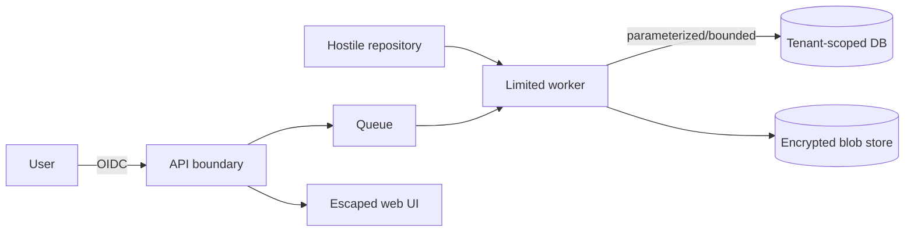

# Security Threat Model

## Assets and trust boundaries

Assets are private source, credentials, tenant/index data, match evidence, service availability, and result integrity. Untrusted repository bytes cross into sandboxed workers; users cross the API authorization boundary; workers cross database/blob/queue boundaries; the browser renders untrusted source text.

| Threat | Control | Verification |
|---|---|---|
| source execution/build hooks | parse bytes only; no compiler/import/build invocation; sandbox/no egress | TC-SEC-001 |
| traversal/symlink escape | descriptor-relative walk, canonical-root check, no-follow default, cycle detection | TC-SEC-002/003 |
| decompression/size/depth/token bombs | byte/file/depth/token/time/memory/posting quotas | TC-SEC-004..007 |
| malformed parser exploit | pinned parsers, isolation, fuzzing, process limits | parser fuzz suite |
| tenant data exposure | tenant authorization on every service/query, row-level defense, opaque IDs | API auth tests |
| credential/log leakage | credential references, URL redaction, structured allowlisted logging | TC-SEC-008, TC-OBS-001 |
| source retention leak | encryption, least privilege, TTL, auditable deletion, no raw-source telemetry | TC-SEC-009/010 |
| stored XSS | contextual escaping, CSP, source as text, no HTML interpretation | web security test |

Residual risks include parser zero-days, collision-based denial of service, poisoned benchmark corpora, and administrator access. Production requires dependency scanning, signed artifacts, incident response, backup protection, and periodic threat-model review. Similarity output must not be presented as a legal judgment.
