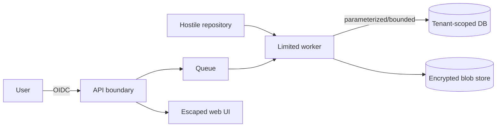

# Security Threat Model

## Assets and trust boundaries

Assets are private source, credentials, tenant/index data, match evidence, service availability, and result integrity. Untrusted repository bytes cross into sandboxed workers; users cross the API authorization boundary; workers cross database/blob/queue boundaries; the browser renders untrusted source text.

| Threat | Control | Verification |
|---|---|---|
| source execution/build hooks | parse bytes only; no compiler/import/build invocation; sandbox/no egress | TC-SEC-001 |
| traversal/symlink escape | descriptor-relative walk, canonical-root check, no-follow default, cycle detection | TC-SEC-002/003 |
| decompression/size/depth/token bombs | byte/file/depth/token/time/memory/posting quotas | TC-SEC-004..007 |
| malformed parser exploit | pinned parsers, isolation, fuzzing, process limits | parser fuzz suite |
| tenant data exposure | tenant authorization on every service/query, row-level defense, opaque IDs | API auth tests |
| credential/log leakage | credential references, URL redaction, structured allowlisted logging | TC-SEC-008, TC-OBS-001 |
| source retention leak | encryption, least privilege, TTL, auditable deletion, no raw-source telemetry | TC-SEC-009/010 |
| stored XSS | contextual escaping, CSP, source as text, no HTML interpretation | web security test |
| optional behavioral verification escapes | disabled by default; explicit authorization; disposable no-network sandbox; read-only inputs; syscall/CPU/memory/PID/time/output limits | TC-T4-008..010 |

M11 centralizes the implemented boundary decisions in [ADR-007](adr/ADR-007-production-security-boundaries.md). API bodies and concurrent scans have configurable admission limits; raw source display defaults off; safe request telemetry records only method, path, status, request ID, and elapsed time; and responses carry no-store, no-sniff, referrer, and restrictive CSP headers. Compose runs services non-root with read-only roots, dropped capabilities, PID and scratch limits, and an internal backend network. Production ingress and orchestrator policy remain responsible for chunked-body enforcement, wall-time termination, syscall policy, and network policy beyond the local Compose reference.

Residual risks include parser zero-days, sandbox/runtime zero-days, collision-based denial of service, poisoned models/corpora, and administrator access. Normal scanning and Types 1–3 never execute analyzed source. Optional Phase 4 behavioral verification is a separate explicitly authorized service and cannot be enabled implicitly by repository contents. Production requires dependency/model scanning, signed artifacts, incident response, backup protection, and periodic threat-model review. Similarity output must not be presented as a legal judgment.

M14's local behavioral runner is a defense-in-depth harness, not a container boundary. It refuses execution unless both explicit enablement and a caller-provided no-network isolation attestation are present. Isolated interpreter startup, an empty environment, a temporary working directory, and POSIX resource limits then bound the child. The deployment layer remains responsible for no-egress networking, read-only inputs, syscall filtering, disposable identity/filesystem, and process termination. See [ADR-008](adr/ADR-008-semantic-verification-policy.md).
