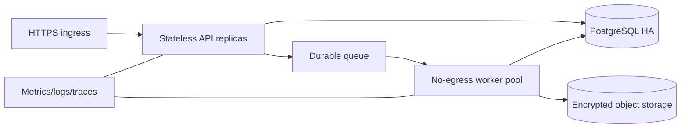

# Deployment Architecture

Local mode packages CLI, engine, and SQLite-free in-memory or PostgreSQL-backed workflows without authentication on loopback. Production uses OCI images for API/web and restricted workers, managed PostgreSQL, durable queue, and encrypted object storage.

Workers run non-root with read-only filesystem, scratch quota, CPU/memory/PID/time limits, seccomp/AppArmor equivalent, and no network egress except explicitly required storage endpoints. Secrets arrive through a secret manager as short-lived credentials. API rolls independently; schema migrations use expand/contract and precede dependent code. Readiness checks database/queue compatibility; liveness is process-only.

Backups are encrypted and restore-tested; deletion outbox lag and queue age are alerted. Autoscaling uses queue depth and job age with tenant concurrency caps. Rollback retains backward-compatible schemas and immutable algorithm versions so existing indexes remain readable.

The M11 Compose reference makes the backend network internal, runs all application containers as numeric non-root users with read-only roots, drops Linux capabilities, enables `no-new-privileges`, caps PIDs, and provides size-limited temporary filesystems. The worker receives no published port. Hosted deployments must additionally set a bearer credential, keep `OPENCODE_EXPOSE_SOURCE=false` unless an approved source-retention policy exists, enforce the request limit at ingress, inject secrets without environment-file commits, terminate over-time jobs at the container boundary, and apply an orchestrator egress policy.
