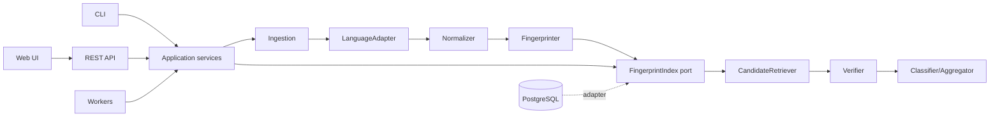

# Architecture Contract

## Dependency rule

The domain package has no dependency on HTTP, CLI, worker, web, or concrete database packages. Adapters depend inward on ports; orchestration owns transactions.



## Required ports

```typescript
type AlgorithmVersion = "fp-v1";
type NormalizationVersion = "norm-v1";
type Mode = "exact" | "renamed";
type Token = {kind: string; canonical: string; startByte: number; endByte: number;
  startLine: number; startColumn: number; endLine: number; endColumn: number};
interface LanguageAdapter { id: string; supports(path: string, prefix: Uint8Array): boolean;
  tokenize(source: Uint8Array): AsyncIterable<Token>; }
interface Normalizer { version: NormalizationVersion; normalize(tokens: AsyncIterable<Token>, mode: Mode): AsyncIterable<Token>; }
interface Fingerprinter { version: AlgorithmVersion; generate(tokens: AsyncIterable<Token>, mode: Mode): AsyncIterable<Fingerprint>; }
interface FingerprintIndex { replaceRevision(input: RevisionFingerprintSet): Promise<void>;
  postings(query: FingerprintQuery): AsyncIterable<Posting>; deleteRepository(id: string): Promise<void>; }
interface CandidateRetriever { retrieve(query: QueryFingerprints, policy: RetrievalPolicy): AsyncIterable<Candidate>; }
interface Verifier { verify(query: NormalizedFragment, candidate: Candidate): Promise<VerifiedMatch[]>; }
```

## Processing invariants

1. Ingestion creates a content-addressed revision before derived work begins.
2. A scan pins adapter, normalization, fingerprint, and policy versions.
3. Index replacement and scan state transition occur in one database transaction after fingerprint generation succeeds.
4. Retrieval is approximate/high-recall; verification alone creates clone matches.
5. Raw source remains in a restricted blob abstraction and is not required by the index.
6. Web/API/CLI expose the same application services and result schemas.

## Failure semantics

Cancellation is cooperative between files and token batches. Individual-file failures are recorded; strict mode fails the scan, while default mode completes with `partial` status. Retried jobs are idempotent by scan ID and revision checksum. See [data-model.md](data-model.md) and [algorithm-contracts.md](algorithm-contracts.md).
